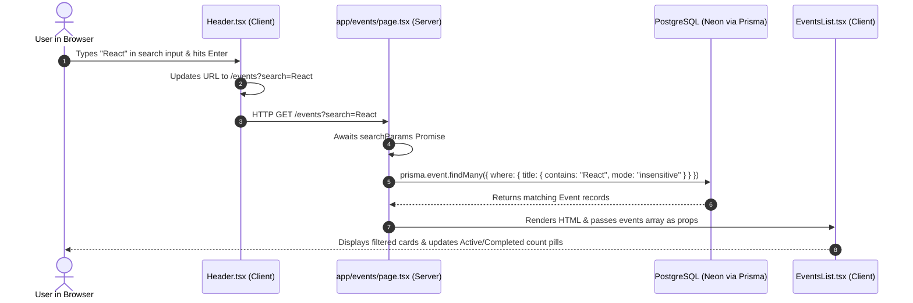
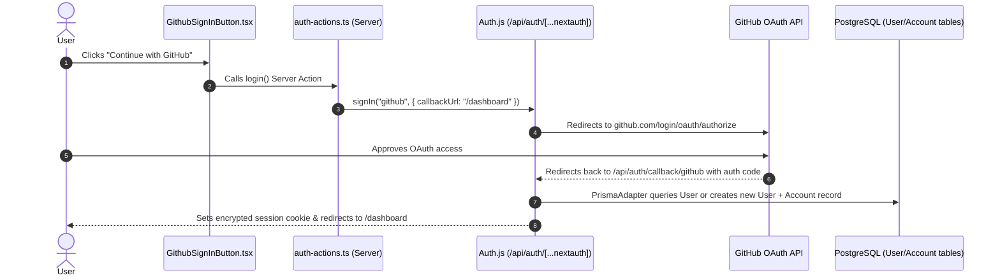
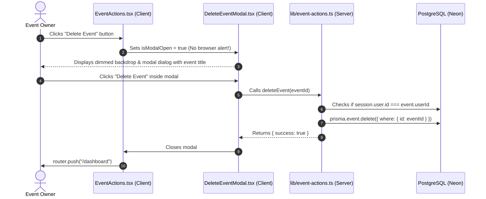

# EventPlanner: The Comprehensive Guide & Next.js Learning Architecture

> **Welcome to your codebase!**  
> This guide is crafted to transform your Next.js project into an engaging, structured learning masterclass. Whether you want to explain this project in technical interviews, customize its features, or build full-stack web applications from scratch, this document is your definitive companion.

---

## Table of Contents

1. [The Big Picture](#1-the-big-picture)
   - [What is EventPlanner?](#what-is-eventplanner)
   - [Tech Stack Architecture](#tech-stack-architecture)
   - [The Restaurant Analogy](#the-restaurant-analogy)
2. [Project Structure & Anatomy](#2-project-structure--anatomy)
   - [Directory Tree](#directory-tree)
   - [Deep-Dive File Breakdown](#deep-dive-file-breakdown)
3. [Core Next.js & React 19 Concepts in Action](#3-core-nextjs--react-19-concepts-in-action)
   - [Concept 1: App Router & File-System Routing](#concept-1-app-router--file-system-routing)
   - [Concept 2: Next.js 15 Async Route Parameters (`params` & `searchParams`)](#concept-2-nextjs-15-async-route-parameters-params--searchparams)
   - [Concept 3: React Server Components (RSC) vs. Client Components](#concept-3-react-server-components-rsc-vs-client-components)
   - [Concept 4: Server Actions (`"use server"`)](#concept-4-server-actions-use-server)
   - [Concept 5: React 19 `useActionState` Form Management](#concept-5-react-19-useactionstate-form-management)
   - [Concept 6: Cache Revalidation (`revalidateTag`)](#concept-6-cache-revalidation-revalidatetag)
   - [Concept 7: Authentication with Auth.js (NextAuth v5) & Prisma Adapter](#concept-7-authentication-with-authjs-nextauth-v5--prisma-adapter)
   - [Concept 8: Database Modeling & Singleton Prisma Client](#concept-8-database-modeling--singleton-prisma-client)
   - [Concept 9: Modern UI Styling with Tailwind CSS v4](#concept-9-modern-ui-styling-with-tailwind-css-v4)
4. [End-to-End User Journeys](#4-end-to-end-user-journeys)
   - [Journey 1: Event Discovery & Real-Time Filtering](#journey-1-event-discovery--real-time-filtering)
   - [Journey 2: Signing in via GitHub OAuth](#journey-2-signing-in-via-github-oauth)
   - [Journey 3: Creating an Event with Zod Validation](#journey-3-creating-an-event-with-zod-validation)
   - [Journey 4: Interactive RSVPing with Database Upsert](#journey-4-interactive-rsvping-with-database-upsert)
   - [Journey 5: Deleting an Event with the Custom Modal](#journey-5-deleting-an-event-with-the-custom-modal)
5. [The Practical 5-Level Learning Roadmap](#5-the-practical-5-level-learning-roadmap)
6. [Troubleshooting & Gotchas](#6-troubleshooting--gotchas)
7. [Developer Cheat Sheet & Quick Recipes](#7-developer-cheat-sheet--quick-recipes)
8. [Knowledge Check & Challenges](#8-knowledge-check--challenges)
   - [10 Architectural Questions](#10-architectural-questions)
   - [5 Hands-On Coding Challenges](#5-hands-on-coding-challenges)
   - [3 Real-World Debugging Scenarios](#3-real-world-debugging-scenarios)
   - [Answer Key & Hints](#answer-key--hints)

---

## 1. The Big Picture

### What is EventPlanner?

**EventPlanner** is a production-grade, full-stack web application designed for organizing and discovering tech meetups, conferences, and community gatherings.

It solves real problems for two distinct user personas:
1. **Event Organizers:** Can publish events with precise venues, datetime scheduling, capacity constraints, public/private toggles, monitor live attendance numbers, and delete concluded or canceled listings.
2. **Community Attendees:** Can search and filter events in real-time, view detailed agendas and organizer credentials, and RSVP with one-click status updates (`GOING`, `MAYBE`, `NOT_GOING`).

### Tech Stack Architecture

| Layer | Technology | Version | Purpose in this Project |
| :--- | :--- | :--- | :--- |
| **Framework** | Next.js (App Router) | `15.3.9` | Server-side rendering, file-based routing, API routes, Server Actions |
| **Frontend Runtime** | React & React-DOM | `19.0.0` | React Server Components (RSC), `useActionState`, client hooks |
| **Language** | TypeScript | `^5.0.0` | Strict static typing across database schemas, props, and actions |
| **Database & ORM** | Prisma ORM + PostgreSQL (Neon) | `6.10.1` | Relational data schema, type-safe queries, connection pooling |
| **Authentication** | Auth.js (NextAuth v5 beta) | `5.0.0-beta.25` | GitHub OAuth, session cookies, database adapter integration |
| **Validation** | Zod | `3.25.67` | Server Action schema parsing and form payload validation |
| **Date Formatting** | date-fns | `4.1.0` | Relative time calculation (`differenceInDays`), localized dates |
| **Styling** | Tailwind CSS v4 | `^4.0.0` | PostCSS v4 engine, CSS `@theme` variables, responsive UI |

---

### The Restaurant Analogy

Understanding a full-stack Next.js 15 application is much easier when you think of it like a **high-end restaurant**:

```
 ┌────────────────────────────────────────────────────────────────────────┐
 │                        THE EVENTPLANNER RESTAURANT                     │
 ├─────────────────────────┬────────────────────────┬─────────────────────┤
 │    FRONT OF HOUSE       │       THE KITCHEN      │     THE PANTRY      │
 │  (Client Components)    │    (Server Components  │ (PostgreSQL & Neon) │
 │                         │    & Server Actions)   │                     │
 │  • EventsList           │  • app/events/page.tsx │  • Event table      │
 │  • Header Search Bar    │  • createEvent action  │  • User table       │
 │  • RSVPButtons          │  • deleteEvent action  │  • RSVP table       │
 │  • DeleteEventModal     │  • auth.ts (Security)  │  • Prisma Client    │
 └─────────────────────────┴────────────────────────┴─────────────────────┘
```

1. **The Dining Area (Browser / Client Components):**
   Where the customer sits. Components marked `'use client'` (like `RSVPButtons.tsx` or `DeleteEventModal.tsx`) represent the tableware, menus, and salt shakers that customers interact with directly. They respond immediately to clicks, key presses, and input changes.
2. **The Kitchen (Server Components & Server Actions):**
   Where meals are prepared out of sight. Files like `app/events/page.tsx` and `lib/event-actions.ts` execute strictly on the server. Customers never touch the kitchen knives or see database passwords (`DATABASE_URL`, `AUTH_SECRET`). The server prepares fresh HTML and data payloads and delivers them to the table.
3. **The Host / Bouncer (`auth.ts` / NextAuth):**
   Checks credentials at the door. Decides whether you can enter the private VIP lounge (`/dashboard`) or publish a new event (`/events/create`).
4. **The Pantry (PostgreSQL via Prisma ORM):**
   The secure storage room where raw ingredients (users, events, RSVPs) are safely kept. Only the kitchen chefs (`prisma.event.findMany`) can enter.

> [!NOTE]
> **Where the analogy stops matching reality:**  
> In a restaurant, the kitchen constantly sends waiters back and forth. In Next.js, Server Components render once into a lightweight stream of HTML and JSON instructions (the RSC payload). Once the page arrives in the browser, React "hydrates" the interactive client components so that client-side page transitions feel instantaneous without reloading the entire page.

---

## 2. Project Structure & Anatomy

### Directory Tree

```
event-planner-nextjs-course/
├── app/                                # Next.js 15 App Router
│   ├── api/                            # REST Route Handlers (Endpoint Layer)
│   │   ├── auth/[...nextauth]/route.ts # Auth.js API handler (OAuth callback)
│   │   ├── dashboard/                  # Dashboard API routes
│   │   │   ├── events/route.ts         # GET current user's events
│   │   │   └── rsvps/route.ts          # GET current user's RSVP list
│   │   └── events/                     # Events API routes
│   │       ├── [eventId]/route.ts      # GET single event JSON
│   │       └── route.ts                # GET filtered events JSON
│   ├── dashboard/                      # Organizer personal dashboard
│   │   └── page.tsx                    # Server Component: user metrics & events
│   ├── events/                         # Events section
│   │   ├── [eventId]/                  # Dynamic route for single event
│   │   │   └── page.tsx                # Server Component: event details & RSVPs
│   │   ├── create/                     # Event creation route
│   │   │   └── page.tsx                # Client Component: form & useActionState
│   │   └── page.tsx                    # Server Component: search & event feed
│   ├── login/                          # Authentication route
│   │   └── page.tsx                    # Server Component: GitHub sign-in page
│   ├── favicon.ico                     # Brand favicon asset
│   ├── globals.css                     # Tailwind CSS v4 directives & theme tokens
│   ├── layout.tsx                      # Root Layout (Sidebar + Header + Shell)
│   ├── not-found.tsx                   # Global 404 UI boundary
│   └── page.tsx                        # Home landing page with hero & CTAs
├── components/                         # Reusable UI component library
│   ├── DeleteEventModal.tsx            # Accessible modal dialog replacing confirm()
│   ├── EventActions.tsx                # Edit & Delete action buttons for owners
│   ├── EventsList.tsx                  # Interactive event grid, tabs & data table
│   ├── GithubSignInButton.tsx          # GitHub OAuth trigger button
│   ├── Header.tsx                      # Sticky topbar with real-time search input
│   ├── RSVPButtons.tsx                 # Interactive RSVP toggle pills (Going/Maybe/No)
│   └── Sidebar.tsx                     # Responsive navigation drawer & user profile
├── lib/                                # Core business logic & database layer
│   ├── auth-actions.ts                 # Server actions for signIn() and signOut()
│   ├── event-actions.ts                # Server actions: create, delete, and rsvp
│   ├── models.ts                       # TypeScript interfaces for Event and RSVP
│   └── prisma.ts                       # Singleton PrismaClient instance
├── prisma/                             # Database configuration & seeding
│   ├── schema.prisma                   # PostgreSQL models (User, Event, RSVP, etc.)
│   └── seed.ts                         # Database seed script with 3 users & 8 events
├── public/                             # Static public assets
├── .env.example                        # Template for required environment variables
├── .env.local                          # Local secrets (DATABASE_URL, AUTH_SECRET)
├── next.config.ts                      # Next.js runtime configuration
├── package.json                        # Scripts, dependencies, and metadata
├── postcss.config.mjs                  # PostCSS plugins for Tailwind v4
└── tsconfig.json                       # TypeScript compiler configuration
```

---

### Deep-Dive File Breakdown

#### 1. [`app/layout.tsx`](file:///d:/New%20folder/Next%20Event%20Planner/event-planner-nextjs-course/app/layout.tsx)
- **Responsibility:** The root shell wrapping every page in the application.
- **Why it exists:** Provides consistent navigation (`Sidebar` and `Header`), loads Geist Google fonts, sets global HTML metadata, and injects session data down to components.
- **How it works:** It is an `async` Server Component. It awaits `auth()`, renders the HTML `<head>` and `<body>`, and frames `{children}` inside the responsive layout.
- **Dependencies:** Imports [`Sidebar.tsx`](file:///d:/New%20folder/Next%20Event%20Planner/event-planner-nextjs-course/components/Sidebar.tsx), [`Header.tsx`](file:///d:/New%20folder/Next%20Event%20Planner/event-planner-nextjs-course/components/Header.tsx), and [`auth.ts`](file:///d:/New%20folder/Next%20Event%20Planner/event-planner-nextjs-course/auth.ts).
- **If changed or removed:** If removed, Next.js will crash because an App Router application requires at least one root `layout.tsx`. If `Sidebar` or `Header` are removed, navigation across all routes disappears.

#### 2. [`lib/prisma.ts`](file:///d:/New%20folder/Next%20Event%20Planner/event-planner-nextjs-course/lib/prisma.ts)
- **Responsibility:** Creates and exports a single, reusable `PrismaClient` database client.
- **Why it exists:** During development, Next.js uses Hot Module Replacement (HMR). Every time you save a file, code re-executes. If you instantiated `new PrismaClient()` naively, every file reload would open a new database connection until PostgreSQL crashes with `too many connections`.
- **How it works:** Stores the client on `globalThis.prisma` when in development mode, ensuring only one instance ever exists.
- **If removed:** Any database query across the entire app will fail immediately.

#### 3. [`lib/event-actions.ts`](file:///d:/New%20folder/Next%20Event%20Planner/event-planner-nextjs-course/lib/event-actions.ts)
- **Responsibility:** Contains secure mutations (`createEvent`, `deleteEvent`, `rsvpToEvent`) executed directly on the server.
- **Why it exists:** Replaces old-fashioned API endpoints with React Server Actions (`"use server"`).
- **Security Check:** Every action calls `await auth()` first to verify the user's session before making any changes in the database.
- **If modified:** If authorization checks are removed, malicious users could delete or modify other people's events.

#### 4. [`components/DeleteEventModal.tsx`](file:///d:/New%20folder/Next%20Event%20Planner/event-planner-nextjs-course/components/DeleteEventModal.tsx)
- **Responsibility:** Replaces disruptive browser `window.confirm()` and `alert()` popups with a polished, accessible modal.
- **Key UX features:** Dimmed blurred backdrop, body scroll lock while open, `Escape` key listener, animated loading spinner, and inline error banner.
- **If removed:** [`EventActions.tsx`](file:///d:/New%20folder/Next%20Event%20Planner/event-planner-nextjs-course/components/EventActions.tsx) will error on import.

---

## 3. Core Next.js & React 19 Concepts in Action

### Concept 1: App Router & File-System Routing

#### 1. The Idea
In Next.js App Router, folders inside `app/` define the URL path in the browser. A file named `page.tsx` makes that URL publicly accessible.

#### 2. Why It Matters
You do not need to configure complex routing tables like `react-router-dom`. The directory structure *is* your router.

#### 3. Where It Appears in EventPlanner
- `app/page.tsx` &rarr; `http://localhost:3000/` (Home page)
- `app/events/page.tsx` &rarr; `http://localhost:3000/events` (Events catalog)
- `app/events/[eventId]/page.tsx` &rarr; `http://localhost:3000/events/cm2...` (Dynamic event detail)
- `app/events/create/page.tsx` &rarr; `http://localhost:3000/events/create` (Event creation form)
- `app/dashboard/page.tsx` &rarr; `http://localhost:3000/dashboard` (Organizer dashboard)
- `app/login/page.tsx` &rarr; `http://localhost:3000/login` (Login screen)

#### 4. The Mental Model
Think of folders as hallways and `page.tsx` as the doorway at the end of the hallway. If a folder doesn't have a `page.tsx`, you cannot stop there—it's just a path segment.

#### 5. Common Mistake
Creating `app/events/create.tsx` instead of `app/events/create/page.tsx`. In the App Router, only folders determine route segments; files named `create.tsx` inside `app/events` are ignored by the router.

---

### Concept 2: Next.js 15 Async Route Parameters (`params` & `searchParams`)

#### 1. The Idea
In Next.js 15, `params` (URL parameters like `[eventId]`) and `searchParams` (query strings like `?search=react`) are **asynchronous Promises** that you must `await`.

#### 2. Why It Matters
Previous Next.js versions treated `params` as synchronous objects. Next.js 15 made them asynchronous to allow the server to start streaming the page before the URL parameters are fully resolved, improving Core Web Vitals.

#### 3. Where It Appears in EventPlanner
Look at [`app/events/[eventId]/page.tsx`](file:///d:/New%20folder/Next%20Event%20Planner/event-planner-nextjs-course/app/events/%5BeventId%5D/page.tsx#L10-L16):

```tsx
export default async function EventPage({
  params,
}: {
  params: Promise<{ eventId: string }>;
}) {
  // Await the asynchronous params object in Next.js 15!
  const { eventId } = await params;
  
  const event = await prisma.event.findUnique({
    where: { id: eventId },
    // ...
  });
}
```

And in [`app/events/page.tsx`](file:///d:/New%20folder/Next%20Event%20Planner/event-planner-nextjs-course/app/events/page.tsx#L6-L13):

```tsx
export default async function EventsPage({
  searchParams,
}: {
  searchParams: Promise<{ search?: string; filter?: string }>;
}) {
  const sp = await searchParams;
  const searchTerm = sp.search; // Read search query
}
```

#### 4. Common Mistake
Destructuring `params` synchronously: `const { eventId } = params;`. In Next.js 15, this will trigger a terminal warning or runtime error: *"`params` should be awaited before using its properties."*

---

### Concept 3: React Server Components (RSC) vs. Client Components

#### 1. The Idea
By default, **every component in the Next.js App Router is a Server Component** unless you explicitly add `"use client"` at the very top of the file.

| Feature | React Server Component (Default) | Client Component (`"use client"`) |
| :--- | :--- | :--- |
| **Where it runs** | Server ONLY | Server during SSR, then Browser |
| **Can access database directly?** | ✅ Yes (`prisma.event.findMany()`) | ❌ No (Cannot import DB clients) |
| **Can use secrets & private env vars?** | ✅ Yes (Safe from browser leaks) | ❌ No (Exposed in bundle if not protected) |
| **Can use `useState`, `useEffect`?** | ❌ No | ✅ Yes |
| **Can handle user clicks & events?** | ❌ No | ✅ Yes (`onClick`, `onChange`, `onSubmit`) |
| **Impact on JS bundle size** | 0 KB sent to client browser | Adds to client JavaScript bundle |

#### 2. Where It Appears in EventPlanner
- **Server Components:** [`app/events/page.tsx`](file:///d:/New%20folder/Next%20Event%20Planner/event-planner-nextjs-course/app/events/page.tsx), [`app/events/[eventId]/page.tsx`](file:///d:/New%20folder/Next%20Event%20Planner/event-planner-nextjs-course/app/events/%5BeventId%5D/page.tsx), [`app/dashboard/page.tsx`](file:///d:/New%20folder/Next%20Event%20Planner/event-planner-nextjs-course/app/dashboard/page.tsx). Notice they directly query `prisma.event` without writing an API endpoint!
- **Client Components:** [`components/EventsList.tsx`](file:///d:/New%20folder/Next%20Event%20Planner/event-planner-nextjs-course/components/EventsList.tsx), [`components/RSVPButtons.tsx`](file:///d:/New%20folder/Next%20Event%20Planner/event-planner-nextjs-course/components/RSVPButtons.tsx), [`components/DeleteEventModal.tsx`](file:///d:/New%20folder/Next%20Event%20Planner/event-planner-nextjs-course/components/DeleteEventModal.tsx), [`components/Header.tsx`](file:///d:/New%20folder/Next%20Event%20Planner/event-planner-nextjs-course/components/Header.tsx). They need `useState`, `onClick`, or `useRouter`.

#### 3. The Mental Model
**"Fetch on the Server, interact on the Client."**  
Fetch data in your Server Component page, then pass that data as `props` to your Client Components. That is exactly how `app/events/page.tsx` works:

```tsx
// Server Component (Kitchen)
const events = await prisma.event.findMany(...);

// Passes data down to Client Component (Dining table)
return <EventsList events={events} />;
```

---

### Concept 4: Server Actions (`"use server"`)

#### 1. The Idea
A **Server Action** is an asynchronous function defined with the `"use server"` directive that you can call directly from your UI components—even Client Components—just like a standard function call. Next.js automatically creates the POST request behind the scenes.

#### 2. Why It Matters
In older React setups, to delete an event you had to:
1. Create an API route (`pages/api/events/delete.ts`).
2. Write manual `fetch("/api/events/delete", { method: "POST", body: JSON.stringify({ id }) })`.
3. Handle JSON serialization, headers, and parsing errors.

With Server Actions, you just call `await deleteEvent(eventId)`!

#### 3. Where It Appears in EventPlanner
Check [`lib/event-actions.ts`](file:///d:/New%20folder/Next%20Event%20Planner/event-planner-nextjs-course/lib/event-actions.ts#L62-L86):

```tsx
"use server";

import { auth } from "@/auth";
import { prisma } from "./prisma";
import { revalidateTag } from "next/cache";

export async function deleteEvent(eventId: string) {
  const session = await auth();
  if (!session?.user?.id) {
    return { success: false, error: "Not authenticated" };
  }

  // Ensure only the organizer can delete their event
  const existingEvent = await prisma.event.findUnique({ where: { id: eventId } });
  if (existingEvent?.userId !== session.user.id) {
    return { success: false, error: "Not authorized to delete this event" };
  }

  await prisma.event.delete({ where: { id: eventId } });
  revalidateTag("events");
  return { success: true };
}
```

---

### Concept 5: React 19 `useActionState` Form Management

#### 1. The Idea
React 19 introduced `useActionState` as the official hook for managing form submissions and server action states, replacing the older `useFormState` and `useFormStatus` hooks.

#### 2. Where It Appears in EventPlanner
Inspect [`app/events/create/page.tsx`](file:///d:/New%20folder/Next%20Event%20Planner/event-planner-nextjs-course/app/events/create/page.tsx#L8-L15):

```tsx
"use client";

import { useActionState, useEffect } from "react";
import { createEvent } from "@/lib/event-actions";
import { useRouter } from "next/navigation";

export default function CreateEventPage() {
  const router = useRouter();
  
  // React 19 useActionState hook:
  // [state, formAction, isPending]
  const [state, formAction, isPending] = useActionState(createEvent, {
    success: false,
    eventId: null,
    error: "",
  });

  useEffect(() => {
    if (state.success && state.eventId) {
      router.push(`/events/${state.eventId}`);
    }
  }, [state.success, state.eventId, router]);

  return (
    <form action={formAction}>
      {/* ... form inputs ... */}
      <button type="submit" disabled={isPending}>
        {isPending ? "Publishing..." : "Publish Event"}
      </button>
    </form>
  );
}
```

#### 3. How It Works
1. When the user clicks "Publish Event", React passes the form data to `createEvent`.
2. `isPending` automatically turns `true`, which displays the animated loading spinner and disables double-submissions.
3. When the server action finishes, `state` updates with the returned `{ success, eventId, error }`.
4. If an error occurred (e.g. invalid date or missing title), `state.error` is rendered in red. If successful, `useEffect` redirects to the newly created event page.

---

### Concept 6: Cache Revalidation (`revalidateTag`)

#### 1. The Idea
Next.js aggressively caches rendered routes for maximum performance. When you change data (like adding an RSVP or deleting an event), you must tell Next.js to purge the stale cache and fetch fresh data.

#### 2. Where It Appears in EventPlanner
In [`lib/event-actions.ts`](file:///d:/New%20folder/Next%20Event%20Planner/event-planner-nextjs-course/lib/event-actions.ts#L141-L143):

```tsx
// After updating RSVP in PostgreSQL:
revalidateTag("events");
revalidateTag(`event-${eventId}`);
```

When this runs, any cached view of the events list or this specific event is invalidated immediately. The next visitor gets fresh data from PostgreSQL.

---

### Concept 7: Authentication with Auth.js (NextAuth v5) & Prisma Adapter

#### 1. The Idea
Authentication in this project uses **Auth.js (NextAuth v5 beta)** integrated with the `@auth/prisma-adapter`.

#### 2. Where It Appears in EventPlanner
Inspect [`auth.ts`](file:///d:/New%20folder/Next%20Event%20Planner/event-planner-nextjs-course/auth.ts):

```typescript
import { PrismaAdapter } from "@auth/prisma-adapter";
import NextAuth from "next-auth";
import GitHub from "next-auth/providers/github";
import { prisma } from "./lib/prisma";

export const { handlers, auth, signIn, signOut } = NextAuth({
  adapter: PrismaAdapter(prisma),
  providers: [
    GitHub({
      clientId: process.env.GITHUB_ID!,
      clientSecret: process.env.GITHUB_SECRET!,
      issuer: "https://github.com/login/oauth",
    }),
  ],
});
```

And in [`app/api/auth/[...nextauth]/route.ts`](file:///d:/New%20folder/Next%20Event%20Planner/event-planner-nextjs-course/app/api/auth/%5B...nextauth%5D/route.ts):

```typescript
import { handlers } from "@/auth";
export const { GET, POST } = handlers;
```

#### 3. How NextAuth Catch-All Route Works
The folder `[...nextauth]` is a **catch-all route**. Any request to:
- `/api/auth/signin`
- `/api/auth/callback/github`
- `/api/auth/session`
- `/api/auth/signout`

is automatically intercepted and handled by `handlers.GET` and `handlers.POST` without writing separate controllers for each.

---

### Concept 8: Database Modeling & Singleton Prisma Client

#### 1. Schema Relationships
Open [`prisma/schema.prisma`](file:///d:/New%20folder/Next%20Event%20Planner/event-planner-nextjs-course/prisma/schema.prisma). Notice the three main domain models:

```prisma
model User {
  id        String   @id @default(cuid())
  name      String?
  email     String   @unique
  events    Event[]  // 1-to-many: An organizer can create many events
  rsvps     RSVP[]   // 1-to-many: A user can RSVP to many events
}

model Event {
  id           String   @id @default(cuid())
  title        String
  description  String
  date         DateTime
  location     String
  maxAttendees Int?
  isPublic     Boolean  @default(true)
  userId       String
  user         User     @relation(fields: [userId], references: [id], onDelete: Cascade)
  rsvps        RSVP[]   // 1-to-many: An event has many attendee RSVPs
}

model RSVP {
  id        String     @id @default(cuid())
  status    RVSPStatus // ENUM: GOING, NOT_GOING, MAYBE
  userId    String
  eventId   String
  user      User       @relation(fields: [userId], references: [id], onDelete: Cascade)
  event     Event      @relation(fields: [eventId], references: [id], onDelete: Cascade)

  @@unique([userId, eventId]) // Critical composite constraint!
}
```

> [!IMPORTANT]
> **The `@@unique([userId, eventId])` constraint:**  
> This ensures that a single user cannot have duplicate RSVP records for the same event. If a user clicks `GOING` and then switches to `MAYBE`, Prisma's `upsert` or `findUnique` will update the existing row instead of creating a conflicting record.

---

### Concept 9: Modern UI Styling with Tailwind CSS v4

#### 1. Where It Appears
Open [`app/globals.css`](file:///d:/New%20folder/Next%20Event%20Planner/event-planner-nextjs-course/app/globals.css):

```css
@import "tailwindcss";

@theme {
  --color-background: #f8f9fc;
  --color-primary: #7c3aed;
  --color-secondary: #ec4899;
  --color-foreground: #0f172a;
  --color-muted: #64748b;
  --color-surface: #ffffff;
}

@layer components {
  .card {
    @apply bg-white border border-slate-100 rounded-2xl shadow-sm shadow-purple-500/5;
  }
  .btn-primary {
    @apply bg-violet-600 text-white px-4 py-2.5 rounded-xl font-medium hover:bg-violet-700 transition-all shadow-sm shadow-violet-500/25 cursor-pointer inline-flex items-center justify-center gap-2 text-sm;
  }
}
```

Tailwind v4 eliminates the legacy `tailwind.config.js` in favor of native CSS `@theme` and `@import "tailwindcss"`. This makes styling lightning fast with zero runtime JavaScript overhead.

---

## 4. End-to-End User Journeys

### Journey 1: Event Discovery & Real-Time Filtering



---

### Journey 2: Signing in via GitHub OAuth



---

### Journey 3: Creating an Event with Zod Validation

1. **User action:** Fills out title, date, location, max attendees, and checks "Public event". Clicks "Publish Event".
2. **Client processing:** [`useActionState`](file:///d:/New%20folder/Next%20Event%20Planner/event-planner-nextjs-course/app/events/create/page.tsx#L10) invokes `createEvent` with the native `FormData`. `isPending` turns `true`.
3. **Server verification:**
   - Calls `await auth()`. If no session &rarr; returns `{ success: false, error: "Not authenticated" }`.
   - Parses the payload with `eventSchema.parse(rawData)` using Zod.
   - If validation fails (e.g. empty title) &rarr; catches `z.ZodError` and returns `{ success: false, error: "Title is required" }`.
4. **Database execution:** Executes `prisma.event.create(...)` in Neon PostgreSQL.
5. **Client response:** Returns `{ success: true, eventId: event.id }`. The `useEffect` hook in `CreateEventPage` triggers `router.push("/events/" + eventId)`.

---

### Journey 4: Interactive RSVPing with Database Upsert

1. **User action:** On `/events/[eventId]`, the user clicks the green "Going" pill.
2. **Optimistic/Loading state:** [`RSVPButtons.tsx`](file:///d:/New%20folder/Next%20Event%20Planner/event-planner-nextjs-course/components/RSVPButtons.tsx#L49-L61) disables the button group to prevent duplicate clicks and sets loading status.
3. **Server Action execution:** Calls `rsvpToEvent(eventId, "GOING")`.
4. **Prisma Upsert:**
   ```typescript
   if (existingRSVP) {
     await prisma.rSVP.update({ where: { userId_eventId: ... }, data: { status: "GOING" } });
   } else {
     await prisma.rSVP.create({ data: { userId, eventId, status: "GOING" } });
   }
   ```
5. **Cache Invalidation:** Calls `revalidateTag("events")` and `revalidateTag("event-" + eventId)`.
6. **UI Refresh:** The RSVP count and attendee list on the page update automatically.

---

### Journey 5: Deleting an Event with the Custom Modal



---

## 5. The Practical 5-Level Learning Roadmap

Follow this progressive hands-on curriculum to master the project step by step:

```
  ┌────────────────────────────────────────────────────────┐
  │  Level 5: Build Independently (Build Event Edit Page)  │
  ├────────────────────────────────────────────────────────┤
  │  Level 4: Make Targeted Changes (Custom UI Modals)     │
  ├────────────────────────────────────────────────────────┤
  │  Level 3: Master the Server/Client Boundary            │
  ├────────────────────────────────────────────────────────┤
  │  Level 2: Follow the Code Path (Trace /events)         │
  ├────────────────────────────────────────────────────────┤
  │  Level 1: Get Oriented (Run & Seed the Database)       │
  └────────────────────────────────────────────────────────┘
```

### Level 1 — Get Oriented
- **Goal:** Clone, inspect, and run the project locally.
- **Action:**
  1. Inspect `.env.example` and ensure `.env.local` contains valid database credentials (`DATABASE_URL`).
  2. Run `npm install`.
  3. Run `npx prisma db seed` to seed your database with sample organizers, summits, and RSVPs.
  4. Run `npm run dev` and open `http://localhost:3000`.

### Level 2 — Follow the Code Path
- **Goal:** Trace how a single request travels from the URL to PostgreSQL and back.
- **Action:** Open [`app/events/page.tsx`](file:///d:/New%20folder/Next%20Event%20Planner/event-planner-nextjs-course/app/events/page.tsx). Add a `console.log("Querying database with params:", sp)` statement. Refresh the browser and observe where the log prints (Notice: it prints in your **terminal**, NOT in the browser console, proving it is a Server Component!).

### Level 3 — Master the Server/Client Boundary
- **Goal:** Understand what can and cannot be imported where.
- **Action:** Try importing `prisma` directly into a client component like [`components/RSVPButtons.tsx`](file:///d:/New%20folder/Next%20Event%20Planner/event-planner-nextjs-course/components/RSVPButtons.tsx). Notice the build error Next.js throws. This reinforces that Prisma and private database clients must remain on the server.

### Level 4 — Make Targeted Changes
- **Goal:** Modify existing components without breaking behavior.
- **Action:**
  1. Open [`components/DeleteEventModal.tsx`](file:///d:/New%20folder/Next%20Event%20Planner/event-planner-nextjs-course/components/DeleteEventModal.tsx).
  2. Notice how it listens for `e.key === "Escape"` to close the dialog.
  3. Try changing the warning icon color or adding an event date indicator inside the modal.

### Level 5 — Build Independently (The Capstone Challenge)
- **Goal:** Build the missing feature!
- **Current state:** In [`EventActions.tsx`](file:///d:/New%20folder/Next%20Event%20Planner/event-planner-nextjs-course/components/EventActions.tsx#L48), the "Edit Event" button navigates to `/events/${eventId}/edit`, but that route does not exist yet!
- **Your task:**
  1. Create the folder `app/events/[eventId]/edit/`.
  2. Create `page.tsx` inside it.
  3. Fetch the existing event with Prisma in a Server Component.
  4. Pre-populate the form and create an `updateEvent` Server Action in `lib/event-actions.ts`.

---

## 6. Troubleshooting & Gotchas

### 1. `PrismaClientInitializationError` / Cannot find module `@prisma/client`
- **Symptom:** Terminal or page crashes saying Prisma Client was not found.
- **Cause:** Prisma's generated types and client were not compiled after an install or schema modification.
- **Solution:** Run `npx prisma generate`. In this project, `package.json` includes `"postinstall": "prisma generate"` to automatically prevent this.

### 2. GitHub OAuth `redirect_uri_mismatch`
- **Symptom:** Clicking "Sign In with GitHub" redirects to a GitHub error page.
- **Cause:** The Authorization Callback URL in your GitHub Developer Settings does not match your active environment.
- **Solution:**
  - In development: `http://localhost:3000/api/auth/callback/github`
  - In production (Vercel): `https://your-app.vercel.app/api/auth/callback/github`

### 3. Next.js 15 Async `params` Warning
- **Symptom:** Console warning: *"`params` should be awaited before using its properties"*.
- **Cause:** Accessing `params.eventId` directly without `await params`.
- **Solution:** Always declare `params: Promise<{ eventId: string }>` and `const { eventId } = await params;`.

### 4. Database Connection Timeouts (Neon / PostgreSQL)
- **Symptom:** Database queries hang or fail on serverless functions.
- **Cause:** Missing SSL parameters in the connection string.
- **Solution:** Ensure your `DATABASE_URL` in `.env.local` ends with `?sslmode=require`.

---

## 7. Developer Cheat Sheet & Quick Recipes

### Important NPM Scripts

```bash
# Run local development server with Turbopack
npm run dev

# Compile production build & generate Prisma client
npm run build

# Start production server
npm start

# Run ESLint validation
npm run lint

# Seed database with sample users and events
npm run db:seed
```

### Quick Recipe: How to create a new Server Action

```typescript
// 1. Create function in lib/your-actions.ts
"use server";

import { auth } from "@/auth";
import { prisma } from "@/lib/prisma";
import { revalidateTag } from "next/cache";

export async function toggleSaveEvent(eventId: string) {
  const session = await auth();
  if (!session?.user?.id) throw new Error("Unauthorized");

  // Perform database operation
  // ...
  revalidateTag("events");
  return { success: true };
}
```

### Quick Recipe: How to use a Server Component with Prisma

```tsx
// app/my-page/page.tsx
import { prisma } from "@/lib/prisma";

export default async function MyPage() {
  // Direct database query! No fetch(), no useEffect(), no loading spinner required!
  const data = await prisma.event.findMany({
    orderBy: { date: "desc" },
    take: 5,
  });

  return (
    <ul>
      {data.map((item) => (
        <li key={item.id}>{item.title}</li>
      ))}
    </ul>
  );
}
```

---

## 8. Knowledge Check & Challenges

Test your understanding of the architecture! Try answering without looking at the hints first.

### 10 Architectural Questions

1. Why does [`lib/prisma.ts`](file:///d:/New%20folder/Next%20Event%20Planner/event-planner-nextjs-course/lib/prisma.ts) bind the PrismaClient instance to `globalThis` in development?
2. What is the fundamental difference between the route `app/events/page.tsx` and `app/events/[eventId]/page.tsx`?
3. In [`app/events/create/page.tsx`](file:///d:/New%20folder/Next%20Event%20Planner/event-planner-nextjs-course/app/events/create/page.tsx), why must the file include `"use client"` at line 1?
4. How does [`app/events/page.tsx`](file:///d:/New%20folder/Next%20Event%20Planner/event-planner-nextjs-course/app/events/page.tsx) perform search filtering without sending an API request with `fetch()`?
5. What does the `@@unique([userId, eventId])` attribute in `schema.prisma` prevent?
6. In [`lib/event-actions.ts`](file:///d:/New%20folder/Next%20Event%20Planner/event-planner-nextjs-course/lib/event-actions.ts), what security check prevents Alice from deleting Bob's event?
7. Why are `params` and `searchParams` typed as `Promise` in Next.js 15?
8. In [`components/DeleteEventModal.tsx`](file:///d:/New%20folder/Next%20Event%20Planner/event-planner-nextjs-course/components/DeleteEventModal.tsx), how is background body scrolling prevented while the modal is open?
9. What happens if a user visits `/events/invalid-id-12345`? What function is called?
10. What is the role of `revalidateTag("events")` after an event is deleted?

---

### 5 Hands-On Coding Challenges

1. **Badge Accent:** In [`components/EventsList.tsx`](file:///d:/New%20folder/Next%20Event%20Planner/event-planner-nextjs-course/components/EventsList.tsx), add a visual pill badge on each card displaying whether the event is `Public` or `Private`.
2. **Attendee Threshold Alert:** On `/events/[eventId]`, display an amber banner stating *"Almost full! Only X spots remaining"* when the RSVP count reaches 90% of `maxAttendees`.
3. **Sort By Creation Date:** In `EventsList.tsx`, add a fourth sorting option: "Recently Added" (`createdAt: desc`).
4. **RSVP Avatar Stack:** On the event details page, render the avatar images of the first 5 users who RSVP'd `GOING`.
5. **Build the Edit Event Feature:** Implement `app/events/[eventId]/edit/page.tsx` so organizers can update the title, date, and description of their existing events.

---

### 3 Real-World Debugging Scenarios

1. **The Phantom Session Bug:**  
   *Scenario:* A user signs in with GitHub. The session cookie is created, but `Sidebar.tsx` still shows "Sign In with GitHub" until a hard refresh.  
   *Question:* What could cause a client component to show stale session data, and how do you ensure immediate synchronization?

2. **The Runaway DB Connection Leak:**  
   *Scenario:* Your application is deployed to production. Suddenly, Neon logs show 100 active connections and the app errors with `Too many clients already`.  
   *Question:* Where in the codebase should you check to verify database connections are properly pooled?

3. **The Hydration Warning:**  
   *Scenario:* The browser console outputs: *"Warning: Text content did not match. Server: 'Oct 21, 2026' Client: '21/10/2026'"*.  
   *Question:* Why does this happen with date formatting in React, and how can it be resolved?

---

### Answer Key & Hints

<details>
<summary><b>Click to expand Answer Key & Hints</b></summary>

#### Architectural Questions:
1. **Prisma Singleton:** Next.js HMR reloads files on every code save. Without `globalThis`, each reload creates a new `PrismaClient` instance, quickly exhausting PostgreSQL connection limits.
2. **Static vs Dynamic Route:** `app/events/page.tsx` is a fixed route segment (`/events`). `app/events/[eventId]/page.tsx` is a dynamic route segment where `[eventId]` captures any unique ID from the URL path.
3. **Why `'use client'` in Create Event:** It uses React hooks (`useActionState`, `useRouter`, `useEffect`) and browser form event listeners, which can only execute in a browser client environment.
4. **RSC Direct Query:** It runs on the server during the page request, reading `searchParams` directly and calling `prisma.event.findMany({ where: ... })` straight from the database before streaming HTML.
5. **Unique Composite Constraint:** Prevents a single user from having multiple RSVP records for the same event, allowing clean upserts.
6. **Authorization Check:** `if (existingEvent.userId !== session.user.id)` verifies the currently authenticated user's ID matches the event's `userId` foreign key.
7. **Async Params in Next.js 15:** To allow Next.js to stream the component shell before the route segments or search query strings have completely finished parsing.
8. **Scroll Locking:** In a `useEffect`, setting `document.body.style.overflow = "hidden"` on mount and restoring the original overflow value in the cleanup function.
9. **`notFound()`:** The page calls `notFound()` from `next/navigation`, which intercepts rendering and renders [`app/not-found.tsx`](file:///d:/New%20folder/Next%20Event%20Planner/event-planner-nextjs-course/app/not-found.tsx).
10. **Cache Invalidation:** It purges the cached HTML/data tag for `"events"`, ensuring the next request to `/events` fetches fresh data from the database.

#### Debugging Scenarios:
1. **Phantom Session:** Make sure `auth()` is awaited in the root `app/layout.tsx` and passed directly as a prop to `<Sidebar session={session} />` and `<Header session={session} />`, or use `SessionProvider` with `useSession()`.
2. **DB Connection Leak:** Verify that your Prisma connection string uses the Neon connection pooler URL (`-pooler` in the host name) and that `lib/prisma.ts` uses the global singleton pattern.
3. **Date Hydration Mismatch:** The server renders dates in the server's timezone (e.g. UTC), while the client browser formats in the user's local timezone. Solution: format dates in an isolated client component after mounting, or pass pre-formatted ISO strings.

</details>

---

*This guide was generated for your Next.js EventPlanner project. Happy coding and building!*
